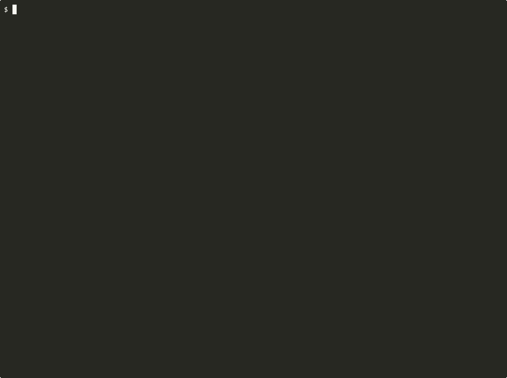

# NREKI - Bulletproof Shield for AI Coding Agents

<p align="center">
  
  
  
  
  
  
</p>

**MCP plugin that validates AI agent edits in RAM before they touch disk.** When Claude Code, Cursor, or Copilot changes a function signature in one file and breaks 30 others, NREKI catches it in milliseconds - the file is never written. If the error is structural (missing import, forgotten `await`), NREKI auto-fixes it in RAM. Zero tokens wasted on fix-retry doom loops.

**Unreleased — Spanish/hybrid recall, symbol deletion, and opt-in native edit preflight.** By default, NREKI writes its session marker without opening any local IPC socket or pipe: the Claude hook keeps large-file `Read` steering active and lets native `Edit`, `MultiEdit` and `Write` pass silently. Claude instructions (`CLAUDE.md`, `SKILL.md`, and MCP initialization) use native `Edit` for single-file changes and reserve `nreki_code action:"batch_edit"` for cross-file signature changes and renames (`AGENTS.md` keeps the `batch_edit` + checker workflow for Codex). `edit` and `batch_edit` also accept `mode:"replace"` with `new_code:""` to delete a symbol under full AST and compiler validation, and `context` / hybrid search bridges Spanish software/business terms into English on the lexical side while keeping exact names, paths and Voyage queries unchanged.

Opting in with `NREKI_NATIVE_PREFLIGHT=1` enables the Claude hook v5 authenticated local IPC preview for native `Edit`, `MultiEdit` and `Write`: accepted edits add no hook output, and rejected edits return diagnostics before the native tool writes. That opt-in preview never writes proposed code or auto-heals, restores the kernel under the same lock, enforces comment-only Anti-Sweep checks plus an opt-in-only differential TypeScript AST zero-`any` check (`batch_edit` does not enforce zero-`any` by default), and batches external watcher refreshes without redundant compiler baseline rebuilds. Declaration surface checks strip JSDoc/comments (preserving triple-slash directives) so comment-only edits report an unchanged exported API in both `batch_edit` footers and preflight, while modules containing `export *` or `export =` are never treated as purely additive so new exports cannot silently shadow re-exported names in consumers outside the active `tsconfig`. This preflight cannot make the later native write atomic with validation: use `batch_edit` for transactional multi-file writes. The hook does not intercept shell writes.

**v12.1.2 — fixes from an external audit of 12.1.1.**
- Secrets are blanked across a typed or commented initializer before code is sent to the optional Voyage index.
- NREKI never writes its own files (`.nreki/…`) through a link; the installed hook is v4.
- `context` shows an imported helper only from the file that declares it.
- The footer reports importers compiled by another tsconfig, in project mode too.
- Sibling anonymous callbacks keep their own errors in the error baseline.
- See [CHANGELOG.md](CHANGELOG.md#1212---2026-11-14).

**v12.1.1 — context finds every issue, safer by default.**
- `context` searches every issue that names no code: a named type or a capitalized word no longer cancels that search. `path` scopes it.
- Importers are resolved the way the compiler resolves them, tsconfig aliases included, so the footer no longer calls an unchecked importer "no importers".
- Fixes from an external audit:
  - no writes through symbolic links;
  - more sensitive files blocked;
  - secrets blanked before code is sent to the optional Voyage index;
  - auto-heal no longer reports fixes it did not make.
- See [CHANGELOG.md](CHANGELOG.md#1211---2026-11-14).

**v12.1.0 — fewer turns, honest footers.** `nreki_navigate action:"context"` returns, in one call, the code a task names; for a task that names no code it returns the best hits of each issue. The `[Validated]` footer says when re-running tsc is redundant. `Class.method` names work everywhere, and an optional Voyage index adds semantic search. Measured with Codex on two new projects, three pairs each: 33 % fewer tokens, then 1.8 % more (see [Token cost](#token-cost)). Also included are the fixes from two external security and integrity audits. See [CHANGELOG.md](CHANGELOG.md#1210---2026-11-13).

**v12.0.0 — Edit-Safety MCP (BREAKING).** NREKI is an edit-safety layer: it validates and atomically commits agent edits, and provides local code navigation. Host agents bring their own semantic retrieval. **`hybrid_search` (NREKI + BM25 RRF fusion) was removed** — its +10pp recall did not justify the ~4.3× token cost for a use case that does not exist when the agent already has grep. `search` (BM25 keywords + dependency topology, with an optional Voyage semantic index) and `fast_grep` (RAM-resident exact substring) cover local navigation; `nreki_code` batch-edits with in-RAM compiler/LSP validation. See [CHANGELOG.md](CHANGELOG.md#1200) for the migration path. (v11.0.0 removed ONNX embeddings; v12.0.0 removed the hybrid_search fusion — same precedent.)

<p align="center"></p>

## Install

```bash
# Claude Code (macOS / Linux)
claude mcp add nreki -- npx -y @ruso-0/nreki

# Claude Code (Windows) — wrap with `cmd /c`, otherwise Claude Code warns
# that the server failed to start (npx is a .cmd shim on Windows):
claude mcp add nreki -- cmd /c npx -y @ruso-0/nreki

# Cursor / any MCP client - add to mcp.json:
# macOS/Linux:
{ "mcpServers": { "nreki": { "command": "npx", "args": ["-y", "@ruso-0/nreki"] } } }
# Windows:
{ "mcpServers": { "nreki": { "command": "cmd", "args": ["/c", "npx", "-y", "@ruso-0/nreki"] } } }

# Optional: agent-aware instructions install (v11.3.0+)
npx @ruso-0/nreki init               # auto-detect agent (Claude Code / Cursor / Cline / Copilot / generic)
npx @ruso-0/nreki init --agent cursor # explicit; valid: claude, cursor, cline, copilot, generic
npx @ruso-0/nreki init --dry-run     # preview the plan, write nothing
npx @ruso-0/nreki init --force       # rewrite an existing NREKI block (your own content in the file is kept)
```

What `nreki init` writes per agent:

| Agent     | Detected via                          | Files installed                                                       |
|-----------|----------------------------------------|-----------------------------------------------------------------------|
| `claude`  | `.claude/` or `CLAUDE.md`              | `CLAUDE.md` (NREKI block), `.claude/skills/nreki-optimizer/SKILL.md`, `.claude/hooks/nreki-enforcer.mjs`, `.claude/settings.json` |
| `cursor`  | `.cursor/` or `.cursorrules`           | `.cursor/rules/nreki.mdc` (with `alwaysApply: true` frontmatter)      |
| `cline`   | `.clinerules` (file or dir)            | `.clinerules/nreki.md`                                                |
| `copilot` | `.github/copilot-instructions.md`      | `.github/copilot-instructions.md` (appended)                          |
| `generic` | none of the above                      | `AGENTS.md`                                                           |

First MCP run indexes the project automatically in the background — `fast_grep` returns RAM-resident substring matches immediately while NREKI's semantic index warms (v11.2.1+). Zero config for TS/JS; point a `tsconfig.json` at your code and NREKI detects the right validation mode.

## How it works

```
AI proposes edit -> NREKI intercepts in RAM -> Compiler/LSP validates
  |                                              |
  |   No errors ----------------------> Two-Phase Atomic Commit to disk
  |   Errors found --> Auto-Heal (TS CodeFix + LSP codeAction, atomic)
  |                        |
  |        Fixed all? ---> Commit to disk
  |        Some remain? -> Full rollback. Disk untouched. Errors returned to agent.
```

Three tools (`nreki_navigate`, `nreki_code`, `nreki_guard`), 26 actions (11 navigate + 6 code + 9 guard), 4 languages (TS/JS, Go via gopls, Python via pyright). Works with any MCP-compatible agent. Apache 2.0.

### Token cost

Depending on the client, an agent pays NREKI's three tool definitions (~700 tokens) on every request of a session or once when it looks them up, and every tool result again on each later request. NREKI saves tokens only when it saves more than that: fewer turns and smaller results than the agent's own tools.

- `nreki_navigate action:"context" query:"<the task>"` returns, in one call, the code the task names: symbols verbatim with their line ranges, where the fields it mentions occur, and who imports each file. Exploring with `map`/grep/reads usually takes two or three turns.
- `read`/`compress` with `focus:"a,b"` return only those symbols; edits return one line plus the `[Validated: …]` footer.
- Measured with Codex (2026-11-13) on synthetic TypeScript projects of 30–40 files, three pairs per run. The first run cost 25 % more tokens with NREKI: `read` ignored `focus`, agents re-read what `context` returned, and took extra turns. After those fixes, a pre-registered run was a tie (+0.02 %) and a run on a new project cost +4.97 %: `context` saved the reading turns, but agents sent `batch_edit` alone and ran the checker on the next turn. With `context` now asking for the checker in the same cell, a run on another new project used **33 % fewer tokens**: 225,391 vs 336,643, 12 vs 18 turns, NREKI ahead in all 3 pairs, all 6 solutions correct. Every NREKI session took the minimum 4 turns: checker, `context`, `batch_edit` plus checker, answer. That is one project and three pairs: a measurement, not a guarantee. On a third new project (42 files) the published 12.1.0 cost 1.8 % more. In two of its three sessions `context` let one capitalized word ("Station", a type) stand for the whole task and returned none of the files to fix. 12.1.1 searches every issue that names no code. One pair on yet another new project, run on the 12.1.1 code before release, used 40.85 % fewer tokens: 449,645 vs 760,190, 21 vs 36 turns, both solutions correct. That is one session per arm, and the agents delegated differently. All runs after the fixes had the optional Voyage index on (see Privacy). In that last pair it made no query, so the default, `context` with BM25 alone, has not been measured on its own.

## Highlights

- **Atomic multi-TextEdit healing.** When gopls or pyright proposes a quickfix with coupled edits (import + usage), NREKI applies every TextEdit of the chosen action together with per-file savepoints and bottom-up offset ordering. No more doom-loop retries where only the import lands and the usage stays broken.
- **Tolerant Patch mode.** `nreki_code action:"edit" mode:"patch"` now retries with indent-flexible matching when the exact-indent search fails and the content is unique. The literal-`$` guarantee is preserved end-to-end (no V8 `$&` / `$$` substitution surprises).
- **Cognitive Enforcer.** Agents can't `batch_edit` blindly - every edit in a batch is validated against a per-file passport (outline seen? symbol focused?). The v10.5.7 fix closed a bypass where 2+ edits could smuggle blind mutations through.
- **TTRD Bounties.** Successful strict-type restoration reports the exact CFI (Cognitive Friction Index) discount to the agent. Pavlovian reinforcement that actually quantifies what improved.
- **Defect radar + ghost oracle.** Four inline detectors and a 0-ext-refs tagger run during `outline` - free signals, no extra tool call.
- **Executable engrams.** Pin insights to symbols. Engrams prefixed `ASSERT` survive AST mutation; everything else invalidates on body change so memory can't go stale.

## Language support (Validation + Auto-heal)

| Language | Validation | Auto-heal |
|----------|------------|-----------|
| TypeScript / JavaScript | Full (TS Compiler API) | TS CodeFix API |
| Go | gopls LSP sidecar | codeAction (atomic) |
| Python | pyright / basedpyright LSP sidecar | codeAction (atomic; basedpyright only — plain pyright validates without healing) |

### What an accepted edit was checked against

Semantic checking is on whenever the project root has a `tsconfig.json`/`jsconfig.json`, a Python marker (`pyproject.toml`, `requirements.txt`, `setup.py`, `Pipfile`) or a `go.mod`; without one, edits get the syntax check only. The `[Validated: …]` footer of every edit states what ran for that edit.

| Project | Checked together with the edit |
|---------|--------------------------------|
| TypeScript, up to 200 files | the edited files and their direct importers (up to 50) |
| TypeScript, 201–1000 files | the whole program |
| TypeScript, over 1000 files | the edited files and their direct importers (up to 50) |
| Go | the edited files, the other files of their package and the files that import them (up to 50) |
| Python | the edited files and the files that import them (up to 50) |

For Go and Python only the errors an edit adds are fatal: an error that was already there does not block it. Transitive importers are not checked in any row but the second; run the compiler or the tests when the footer says so.

## AST parser coverage

NREKI's tree-sitter parser layer indexes additional languages for
foveal compression + symbol retrieval + semantic-edit syntactic
validation. These languages do **not** have LSP sidecars and
therefore receive no auto-heal; otherwise their files participate
in the retrieval index identically to TypeScript files.

| Language    | Extensions                              | Parser | Foveal | Syntax check | LSP auto-heal | Type Ledger |
|-------------|-----------------------------------------|--------|--------|--------------|---------------|-------------|
| TypeScript  | .ts .tsx .mts .cts                      | ✓      | ✓      | ✓            | ✓ (tsc)       | ✓           |
| JavaScript  | .js .jsx .mjs .cjs                      | ✓      | ✓      | ✓            | ✓ (tsc)       | ✓           |
| Python      | .py                                     | ✓      | ✓      | ✓            | ✓ (pyright)   | —           |
| Go          | .go                                     | ✓      | ✓      | ✓            | ✓ (gopls)     | —           |
| CSS         | .css                                    | ✓      | ✓      | ✓            | —             | —           |
| JSON        | .json                                   | ✓      | ✓      | ✓            | —             | —           |
| HTML        | .html                                   | ✓      | ✓      | ✓            | —             | —           |
| **Kotlin**  | .kt .kts                                | ✓      | ✓      | ✓            | —             | —           |
| **Java**    | .java                                   | ✓      | ✓      | ✓            | —             | —           |
| **C++**     | .cpp .cc .cxx .hpp .hh .hxx .h*         | ✓      | ✓      | ✓            | —             | —           |
| **C**       | .c .h*                                  | ✓      | ✓      | ✓            | —             | —           |

Kotlin / Java / C++ / C activation in v11.0.x covers Android development
(Kotlin app layer + Java legacy + C++ NDK native layer + C NDK code) and the
broader JVM / native cross-platform ecosystem.

> *`.h` headers are routed at parse time: headers containing
> C++ markers (template, namespace, class, `#ifdef __cplusplus`)
> use the C++ grammar; pure C headers use the C grammar. Default
> to C grammar for ambiguous cases.

**Known limitation (v11.0.x):** cross-file import detection for
Kotlin / Java / C++ / C is not yet implemented. Repo-map dependency edges
for files in these languages are intra-file only until v11.0.x.1.

### Known limitations (v11.0.1)

**Android XML manifests and Gradle build files are NOT yet indexed.**
AndroidManifest.xml, resource XMLs (`res/layout/`, `res/values/`, etc.),
and Gradle build scripts (`build.gradle` Groovy DSL) coverage is tracked
for v11.0.2 (see issue #4).

**WASM checksum verification deferred.** Upstream grammar upgrades may not
propagate to vendor `wasm/` directory due to skip-if-exists logic in
`scripts/download-wasm.js`. SHA-256 checksum verification tracked as issue #5.

**chunks table lacks language column.** Retrieval language-aware scoring
requires runtime path extension filtering. Breaking migration tracked as
issue #6 (coordinated with v11.0.2 XML activation due to noise risk
amplification).

**Type Ledger (cross-file architectural dependency mapping) remains
TypeScript-specific by design** - it relies on TypeScript compiler-
derived type information. Multi-language Type Ledger expansion is
tracked under the Phase 8 roadmap.

## Privacy: everything is local unless you opt in

By default no code leaves the machine. `search` can optionally add semantic recall (find code by meaning, even when it shares no words with the question) with your own [Voyage AI](https://www.voyageai.com/) key:

```bash
NREKI_SEMANTIC=voyage              # explicit opt-in (required)
NREKI_VOYAGE_API_KEY=pa-...        # or VOYAGE_API_KEY
NREKI_VOYAGE_MODEL=voyage-code-4   # optional, default shown
NREKI_VOYAGE_MAX_TOKENS=20000000   # optional per-process embedding budget
```

- A `VOYAGE_API_KEY` exported for another tool does **not** enable it; `NREKI_SEMANTIC=voyage` does.
- **What is sent:** every indexed code chunk (project-relative path, its comments, up to 6,000 characters of code) is embedded **once**, in the background, and the vector is stored locally in `.nreki.db`. Unchanged chunks are never re-sent, also after a restart; an edited file re-sends only its changed chunks. Each `search` sends only the query. Sensitive paths (`.env`, keys, `.ssh`, …) are never sent; secrets hard-coded in ordinary source files would be.
- **Cost:** about one token per 3.5 characters of code, once. A 1M-token repository is roughly $0.12 at voyage-code-4's list price, inside the free tier Voyage gives each account.
- **How results change:** the dense ranking is fused with BM25 (reciprocal-rank fusion), so a chunk BM25 never retrieved can surface. Until indexing finishes, and whenever Voyage is unreachable (2.5 s timeout) or the key is rejected, search answers from BM25 alone and logs the reason once.
- Check Voyage's terms for data retention/training; on self-serve accounts, opting out of training requires a payment method on file.

### Memory files are signed

NREKI's memory lives in the project folder: engrams, `memorize` notes and the plan pointer (`.nreki.db`), pinned rules (`.nreki/pins.json`), file history and the map cache (`.nreki/`). The agent reads parts of it as its own notes, and a repository could ship such files, so each one is signed with a key kept in your user folder (`~/.nreki/trust.key`, never in a project). A file without a valid signature is never loaded: it is moved to `.nreki/quarantine/` and the index is rebuilt.

Upgrading from 12.0.0 or earlier quarantines your old memory once. To restore it, run `npx @ruso-0/nreki trust-db` in a terminal with the agent session closed: it lists the engrams, notes and pins it found and restores them only after you type `yes`. Without an interactive terminal it refuses, so an agent cannot run it on its own.

## Docs & links

- **[CHANGELOG.md](CHANGELOG.md)** - full version history (every patch, every release, every test count).
- **[templates/CLAUDE.md](templates/CLAUDE.md)** - optimized instructions auto-installed by `npx @ruso-0/nreki init`.
- **Issues / ideas** - GitHub Issues on this repo.

## License

Apache 2.0. Zero cloud dependencies. Everything runs locally in the agent's process (the opt-in Voyage reranker above is the only exception).
